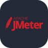

  
  

  

    
    
    
    
  

## At a glance

<table width="100%">
  <tr>
    <td width="33%" valign="top">
      <h3>Role</h3>
      QA engineer for web, mobile and cloud products: test planning, execution, defect triage and release validation.
    </td>
    <td width="33%" valign="top">
      <h3>Experience</h3>
      3+ years in QA across LMS, ERP, POS and SaaS platforms. Currently the sole QA engineer across several concurrent projects at <a href="https://www.wavezync.com/">WaveZync</a>.
    </td>
    <td width="33%" valign="top">
      <h3>Focus</h3>
      Maintainable Playwright automation, API testing, test data tooling and using AI agents to speed up test work.
    </td>
  </tr>
</table>

## About me

I'm a QA engineer who works to take the surprises out of release day. I test web, mobile and cloud products with focused manual testing, practical automation and lightweight performance checks, and I write findings that are clear, actionable and easy to reproduce.

## Tech stack

<table>
  <tr>
    <td><b>Test automation</b></td>
    <td>
      
      
      
      
      
      
    </td>
  </tr>
  <tr>
    <td><b>API &amp; performance</b></td>
    <td>
      
      
      
      
      
      
    </td>
  </tr>
  <tr>
    <td><b>CI/CD &amp; test management</b></td>
    <td>
      
      
      
      
      
    </td>
  </tr>
  <tr>
    <td><b>Data &amp; AI</b></td>
    <td>
      
      
      
    </td>
  </tr>
</table>

## Featured work

<table>
  <tr>
    <td width="50%" valign="top">
      <h3><a href="https://github.com/rameshlakmal/BugSnap">BugSnap</a></h3>
      A Chrome and Edge extension that turns one screen recording into a complete bug report: steps, console errors and a masked network log, with an AI-written report sent to GitHub, Jira or Slack.
        <code>Chrome Extension</code> <code>Node.js</code> <code>ffmpeg</code> <code>Claude</code>
       <a href="https://github.com/rameshlakmal/BugSnap/blob/master/INSTALL.md">Install guide →</a>
    </td>
    <td width="50%" valign="top">
      <h3><a href="https://github.com/rameshlakmal/halden-outfitters">Halden Outfitters</a></h3>
      A realistic outdoor-gear web shop built for QA engineers to practise UI, API and database testing, with 18 planted bugs you can switch on and a separate <a href="https://github.com/rameshlakmal/halden-qa">Playwright suite</a>.
        <code>Playwright</code> <code>PostgreSQL</code> <code>Next.js</code> <code>Fastify</code>
       <a href="https://halden-outfitters.vercel.app">Live demo →</a>
    </td>
  </tr>
  <tr>
    <td width="50%" valign="top">
      <h3><a href="https://github.com/rameshlakmal/propmaster">Propmaster</a></h3>
      A test-data toolkit for PostgreSQL. It records every change a test makes, checks it against business rules written in SQL, and seeds and cleans up scenario data from YAML.
        <code>TypeScript</code> <code>PostgreSQL</code> <code>React</code> <code>Vitest</code>
    </td>
    <td width="50%" valign="top">
      <h3><a href="https://github.com/rameshlakmal/Agentic-Testing">E2E Testing with Claude Agents</a></h3>
      A five-stage pipeline where AI agents analyse an app, plan scenarios and generate page-object Playwright tests, with human review gates and a healer agent that repairs broken tests.
        <code>Playwright</code> <code>Claude</code> <code>Agentic Testing</code>
    </td>
  </tr>
  <tr>
    <td width="50%" valign="top">
      <h3><a href="https://github.com/rameshlakmal/TestPilot-AI">TestPilot AI</a></h3>
      Turns software requirements into prioritised, deduplicated test cases using standard test design techniques, and syncs them to Jira (AIO Tests).
        <code>Anthropic</code> <code>Jira</code>
       <a href="https://testpilot-ai-app.vercel.app/">Live demo →</a>
    </td>
    <td width="50%" valign="top">
      <h3><a href="https://github.com/rameshlakmal/Jmeter-githubActions-influxdb-grafana">JMeter + InfluxDB + Grafana</a></h3>
      Performance tests for OrangeHRM that stream live results to InfluxDB and Grafana dashboards, run on every push by GitHub Actions.
        <code>JMeter</code> <code>InfluxDB</code> <code>Grafana</code> <code>GitHub Actions</code>
    </td>
  </tr>
</table>

<a href="https://github.com/rameshlakmal?tab=repositories">See all repositories →</a>

## Experience

| Role | Company | Period |
| --- | --- | --- |
| **Quality Assurance Engineer** | [WaveZync](https://www.wavezync.com/) | Oct 2024 – Present |
| **Associate Quality Assurance Engineer** | [Impact IT Solutions](https://impactitsolutions.lk/) | Nov 2023 – Oct 2024 |
| **Intern Quality Assurance Engineer** | [Impact IT Solutions](https://impactitsolutions.lk/) | Apr 2023 – Oct 2023 |

- **Certification:** [ISTQB Certified Tester – Foundation Level](https://drive.google.com/file/d/1hr8S8uZQgOqPFGbJGk0RxGoWDqeypaiK/view?usp=sharing) (May 2025)
- **Education:** BSc (Hons) in Information Technology, SLIIT (2020 – 2024)

## GitHub activity

  
  
   
  
   
  

   
  

